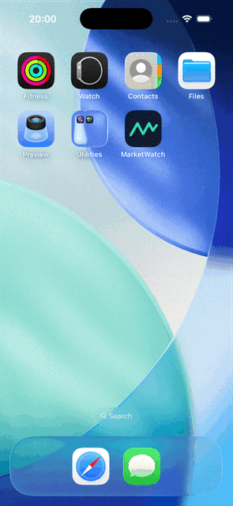
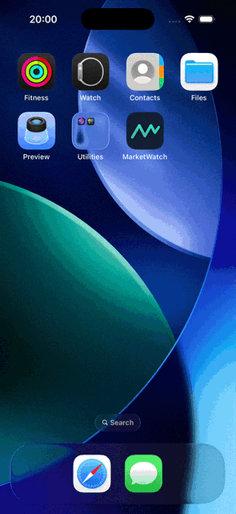
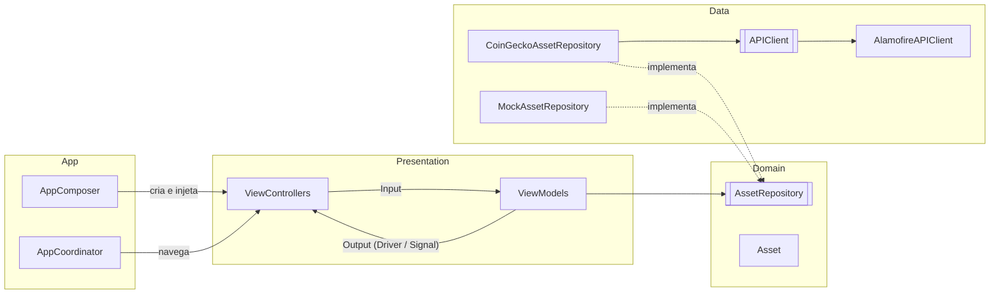

# MarketWatch

[](https://github.com/cesarlima/MarketWatch-iOS/actions/workflows/ci.yml)

App iOS de cotações de criptomoedas feito em UIKit, RxSwift e Alamofire (MVVM, CocoaPods),
com dados da API pública do [CoinGecko](https://www.coingecko.com/en/api).

| Claro | Escuro |
|:---:|:---:|
|  |  |

## Funcionalidades

- Lista de ativos com preço e variação em 24h, paginação ao rolar e puxar para atualizar.
- Busca por nome ou símbolo.
- Detalhe com preço, variação, gráfico de 7 dias e estatísticas de 24h.
- Estados de carregamento e erro com "Tentar novamente", modo escuro e Dynamic Type.

## Como rodar

Requisitos: Xcode 26, CocoaPods e iOS 14 ou superior.

```bash
git clone https://github.com/cesarlima/MarketWatch-iOS.git
cd MarketWatch-iOS
pod install
open MarketWatch.xcworkspace
```

**Cmd+R** roda o app e **Cmd+U** roda os testes.

**Modo mock:** a API do CoinGecko sem chave aceita poucas requisições por minuto. Para usar dados locais,
sem internet, marque `-useMockData` em **Edit Scheme › Run › Arguments**.

## Arquitetura

MVVM com Coordinator, separado em camadas:



| Camada | Responsabilidade |
|---|---|
| `Domain` | Modelos (`Asset`, `AssetPage`), erros do app (`AppError`) e o protocolo `AssetRepository`. Não conhece UIKit nem Alamofire. |
| `Data` | `Endpoint` (rotas e parâmetros), `APIClient` e sua implementação com Alamofire, DTOs com o mapeamento para o domínio, repositório do CoinGecko e repositório mock. |
| `Presentation` | Uma pasta por tela (`AssetList`, `AssetSearch`, `AssetDetail`), cada uma com `ViewModels/` e `Views/`. Em `Common/` ficam a célula, os estados de tela, a formatação de valores, o carregamento de ícones e os textos. |
| `App` | `AppComposer` cria as peças e injeta as dependências pelo `init` (sem singletons). `AppCoordinator` cuida da navegação: as telas avisam a seleção por closure e não se conhecem. |

```
MarketWatch/
├── App/            AppDelegate, SceneDelegate, AppComposer, AppCoordinator
├── Domain/         Asset, AssetPage, AppError, AssetRepository
├── Data/
│   ├── DTOs/
│   ├── Network/    APIClient, AlamofireAPIClient, Endpoint
│   └── Repositories/
├── Presentation/
│   ├── AssetList/
│   ├── AssetSearch/
│   ├── AssetDetail/
│   └── Common/
└── Resources/      Assets, LaunchScreen, Localizable.strings, mock-markets.json
```

## Como o RxSwift é usado

- Cada ViewModel recebe os eventos da tela (`Input`) e devolve `Driver`s e `Signal`s (`Output`),
  que a tela só liga aos componentes.
- **Busca:** `debounce` espera a pausa na digitação e `flatMapLatest` cancela a busca anterior.
- **Lista:** o estado fica num `BehaviorRelay`; carga, atualização e próxima página passam pelo mesmo fluxo.
- As requisições do Alamofire viram `Single` e são canceladas quando a tela descarta a assinatura.
- Os testes usam `RxTest` com tempo virtual.

## Decisões

- "Último fechamento" aparece como "Preço há 24h", porque cripto não tem fechamento oficial.
- Sem atualização automática, por causa do limite da API: os preços se atualizam ao puxar a lista
  e ao abrir o detalhe.
- O gráfico só é carregado no detalhe, para manter a lista leve.
- Não há cache de cotações.

## Licença

MIT
